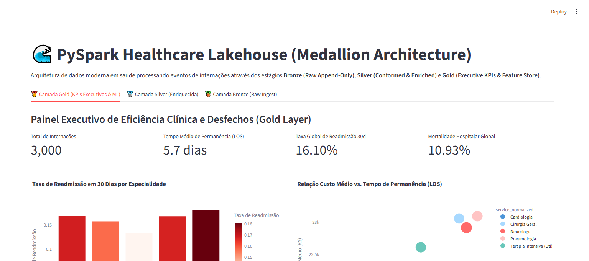

# 🌊 PySpark Healthcare Lakehouse (Medallion Architecture)

[](https://www.python.org/downloads/)
[](#)
[](#)
[](#)
[](#)
[](#)

Pipeline de Engenharia de Dados e Big Data em Saúde implementando a arquitetura **Medallion Lakehouse** (Bronze -> Silver -> Gold) para conformação, cálculo de métricas de tempo de permanência (**LOS**), readmissão em 30 dias e governança hospitalar.

---

## 📸 Validação Visual de Execução (Playwright E2E)

### Painel Executivo da Camada Gold (KPIs Hospitalares & Feature Store)


---

## 🎯 Por que Lakehouse Medallion em Saúde?

Hospitais de grande porte geram petabytes de eventos clínicos não estruturados. Executar queries analíticas diretamente nos bancos operacionais do prontuário ou sistemas laboratoriais resulta em instabilidade e falta de histórico temporal.

A arquitetura Medallion estrutura os dados em três estágios lógicos:
1. **Bronze (Raw Ingest)**: Ingestão de telemetria e eventos de admissão/alta sem transformação, mantendo imutabilidade regulatória (auditoria HIPAA/LGPD).
2. **Silver (Enriched & Conformed)**: Deduplicação temporal, saneamento de tipos, reconstrução de trajetórias de internação e cálculo vetorizado de tempo de permanência e janelas móveis de readmissão em 30 dias.
3. **Gold (Aggregated Business Layer)**: Tabelas analíticas de alto desempenho prontas para BI de diretoria e treinamento de modelos preditivos de ocupação e risco.

---

## 🏛️ Estrutura Arquitetural (CRISP-DM + SDD)

```
pyspark-healthcare-lakehouse/
├── SPEC.md                           # Contratos Pydantic formais de entrada/saída
├── crisp_dm/
│   └── 01_business_understanding.md  # Fundamentação de negócio e estratégia Lakehouse
├── src/
│   ├── schemas.py                    # Schemas Pydantic validados por camada
│   ├── lakehouse_engine.py           # Processamento Medallion (Bronze/Silver/Gold)
│   └── app.py                        # Interface analítica executiva (Streamlit)
├── tests/
│   └── unit/
│       └── test_lakehouse.py         # Testes unitários das transformações com PyTest
├── docs/
│   └── screenshots/                  # Evidências Playwright E2E
├── Dockerfile                        # Implantação em container
└── requirements.txt                  # Dependências fixadas
```

---

## 🧪 Transformações Chave Implementadas

| Camada Lakehouse | Operações Principais | Finalidade de Negócio |
| :--- | :--- | :--- |
| **Bronze** | Ingestão bruta append-only com timestamp | Preservação de linhagem e histórico imutável |
| **Silver** | Cálculo de LOS (`discharge - admission`), janela de readmissão 30d | Limpeza e estruturação centrada no paciente |
| **Gold** | Agregações multidimensionais por serviço clínico | Alocação de recursos, orçamentação e ML Features |

---

## 🚀 Como Executar Localmente

### 1. Clonar o repositório
```bash
git clone https://github.com/generozo-paulo/pyspark-healthcare-lakehouse.git
cd pyspark-healthcare-lakehouse
```

### 2. Instalar dependências
```bash
pip install -r requirements.txt
```

### 3. Rodar suíte de testes unitários
```bash
python -m pytest tests/unit/ -v
```

### 4. Executar Dashboard Lakehouse
```bash
python -m streamlit run src/app.py
```
Acesse em: `http://localhost:8501`

---

## 🐳 Execução via Docker

```bash
docker build -t pyspark-healthcare-lakehouse .
docker run -p 8501:8501 pyspark-healthcare-lakehouse
```

---

## 👨‍💻 Autor

**Paulo Generozo**
- GitHub: [@generozo-paulo](https://github.com/generozo-paulo)
- Especialização: Big Data, Lakehouse & Health Informatics
